<p align="center">
  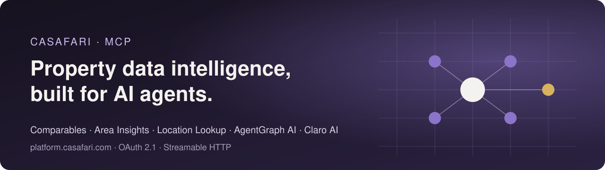
</p>

<p align="center">
  <a href="https://claude.ai/directory/claro-ai-by-casafari"></a>
  <a href="https://registry.modelcontextprotocol.io/v0.1/servers?search=casafari"></a>
  <a href="https://developers.casafari.com"></a>
  <a href="https://platform.casafari.com/console/"></a>
  <a href="LICENSE"></a>
</p>

# Casafari MCP

**Property data intelligence, built for AI agents.** Casafari is the AI agent-native real estate data intelligence platform. Deduplicated, cleaned property graph. Europe's most complete property index.

Connect Claude, ChatGPT, Cursor, VS Code, Gemini CLI or your own agent to five MCP servers on one account: comparables and price estimates, area insights, location lookup, agency analysis in Germany, and **Claro AI**, which finds commercial premises from a brief in plain words. Sign in with OAuth in the browser; there is no key to copy.

```text
/plugin marketplace add casafari/casafari-mcp
/plugin install casafari@casafari
```

<sub>That is the whole setup in Claude Code. Every other client is below.</sub>

## Now in Claude's Connectors Directory

[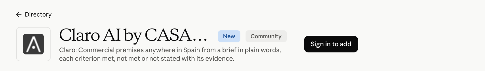](https://claude.ai/directory/claro-ai-by-casafari)

Claro AI is listed in [Claude's Connectors Directory](https://claude.ai/directory/claro-ai-by-casafari): open it in Claude, click **Add**, sign in with your Casafari platform account, and ask.

Claro also searches plots of land in Germany by what their own text says may be built: see the [sample report on commercial plots in Germany](https://casafari.github.io/casafari-mcp/reports/german-plots.html), with counts per Land and four searches run on the live service.

## Now in the Cursor Directory

[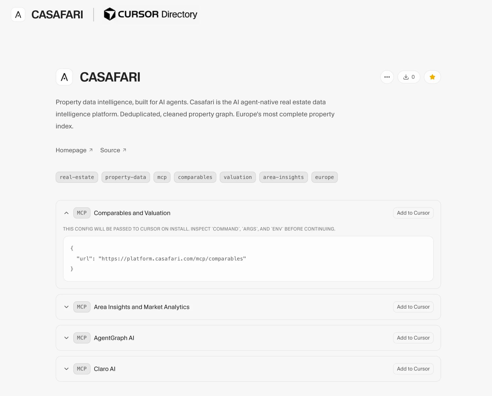](https://cursor.directory/plugins/casafari)

Casafari is listed in the [Cursor Directory](https://cursor.directory/plugins/casafari): open it, click **Add to Cursor** next to a server, and sign in with your Casafari platform account.

## Claro AI in Claude: real sessions

Three moments from real Claude sessions with the Claro AI connector, recorded on 16 October 2026.

**Claude sees the tools.** Ask what Claro can do and Claude lists its ten tools, from a brief in plain words to Location Intelligence for any point in Spain.

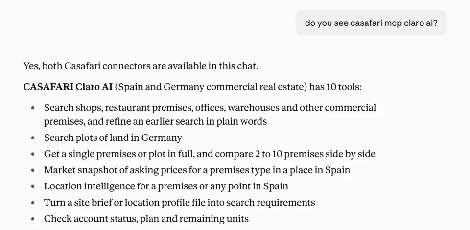

**A brief becomes a ranked shortlist.** *"Specialty coffee shop, retail for rent in Valencia, 40-120 m², street level with shop window, cafetería licence, busy street or near offices and universities, under €3,500 a month."* Claro finds 546 matching premises, and Claude walks through the best six with rent, size, licence, footfall, residents and the cafés already nearby.

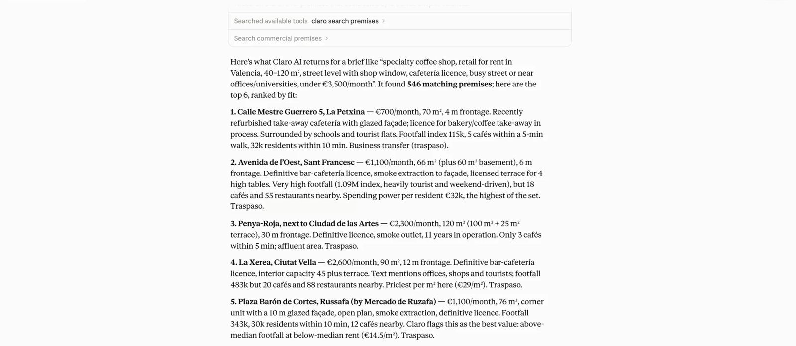

**A committee-ready report, in one conversation.** For a mid-size fitness club across the Madrid and Barcelona metros, Claude screens 483 matches down to seven candidates, scores them, and writes a dossier per site: the case for it, the figures behind it and what due diligence must confirm.

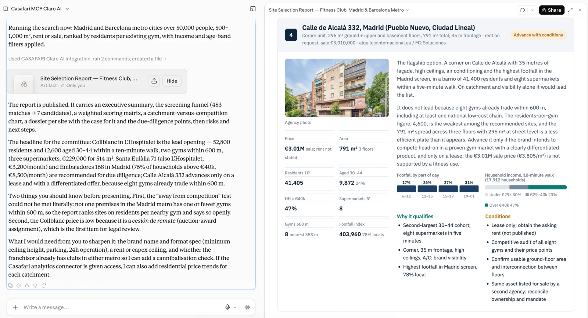

### Example reports

All six are also on the developer hub, with a short brief for each: **[developers.casafari.com/docs/claro/examples](https://developers.casafari.com/docs/claro/examples)**.

Each report was written by Claude from Claro AI data in a single chat. Open either one in your browser; each is one self-contained page.

| | |
|---|---|
| [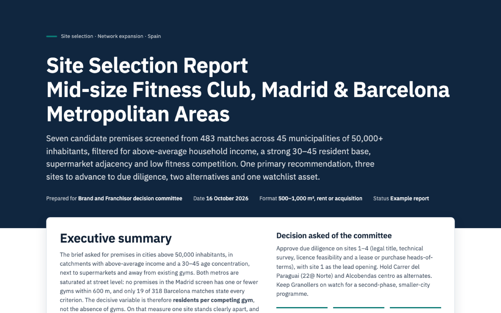](https://casafari.github.io/casafari-mcp/examples/claude-reports/fitness-club-madrid-barcelona.html) | **[Site Selection Report: mid-size fitness club, Madrid and Barcelona metros](https://casafari.github.io/casafari-mcp/examples/claude-reports/fitness-club-madrid-barcelona.html)**<br>483 matches in 45 municipalities of 50,000+ people, ranked on residents per nearby gym; a weighted scoring matrix; seven site dossiers; risks and next steps. |
| [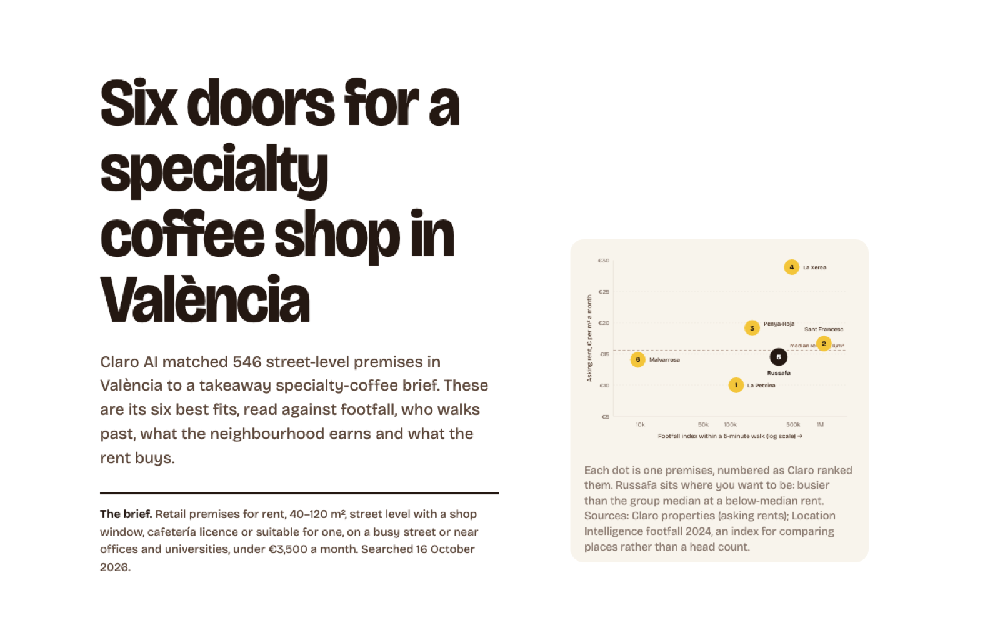](https://casafari.github.io/casafari-mcp/examples/claude-reports/specialty-coffee-valencia.html) | **[Six doors for a specialty coffee shop in València](https://casafari.github.io/casafari-mcp/examples/claude-reports/specialty-coffee-valencia.html)**<br>546 matches, the six best fits mapped by footfall against rent, who walks past and when, what the neighbourhood earns, and where the València rental market is heading. |
| [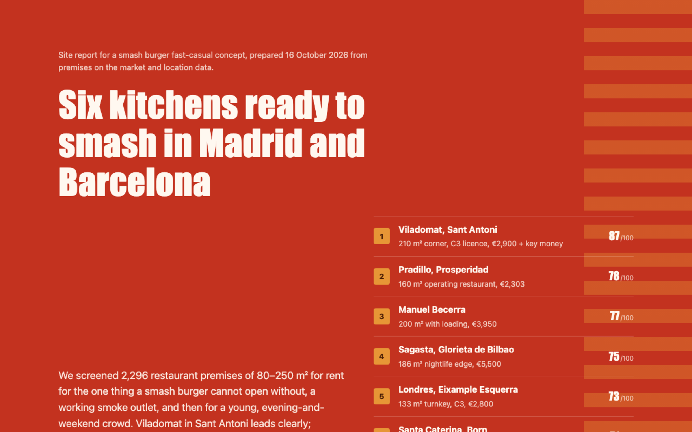](https://casafari.github.io/casafari-mcp/examples/claude-reports/smash-burgers-madrid-barcelona.html) | **[Six kitchens ready to smash in Madrid and Barcelona](https://casafari.github.io/casafari-mcp/examples/claude-reports/smash-burgers-madrid-barcelona.html)**<br>2,296 restaurant premises screened for a working smoke outlet and a young, evening-and-weekend crowd; six kitchens scored out of 100, with rent, key money, licence class and the competition within 500 m. |
| [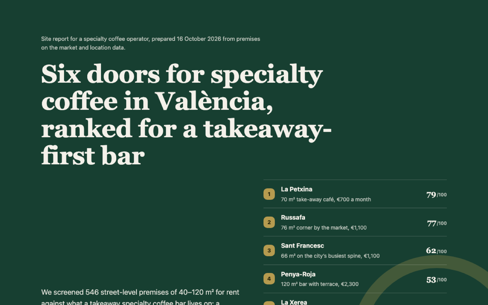](https://casafari.github.io/casafari-mcp/examples/claude-reports/specialty-coffee-valencia-site-report.html) | **[Specialty coffee in València: site report](https://casafari.github.io/casafari-mcp/examples/claude-reports/specialty-coffee-valencia-site-report.html)**<br>546 street-level premises ranked for a takeaway-first coffee bar: morning crowd, regulars who live nearby, a shop window and a licence; the Spanish branded-coffee market in figures. |
| [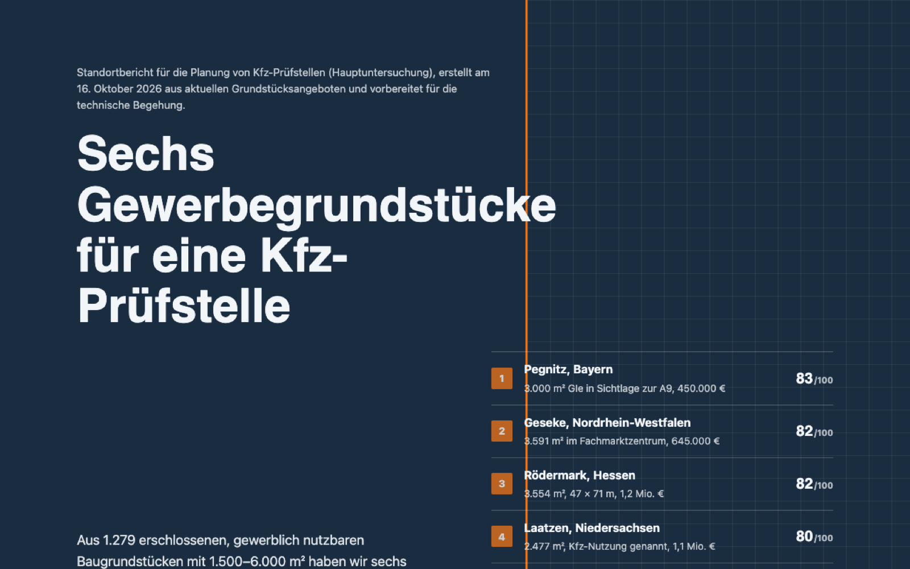](https://casafari.github.io/casafari-mcp/examples/claude-reports/kfz-pruefstellen-gewerbegrundstuecke.html) | **[Sechs Gewerbegrundstücke für eine Kfz-Prüfstelle (German)](https://casafari.github.io/casafari-mcp/examples/claude-reports/kfz-pruefstellen-gewerbegrundstuecke.html)**<br>Commercial plots in Germany: 1,279 serviced plots of 1,500–6,000 m² narrowed to six for a vehicle inspection centre, with planning status, plot shape, road access, a sample site layout and a checklist for the site visit. |
| [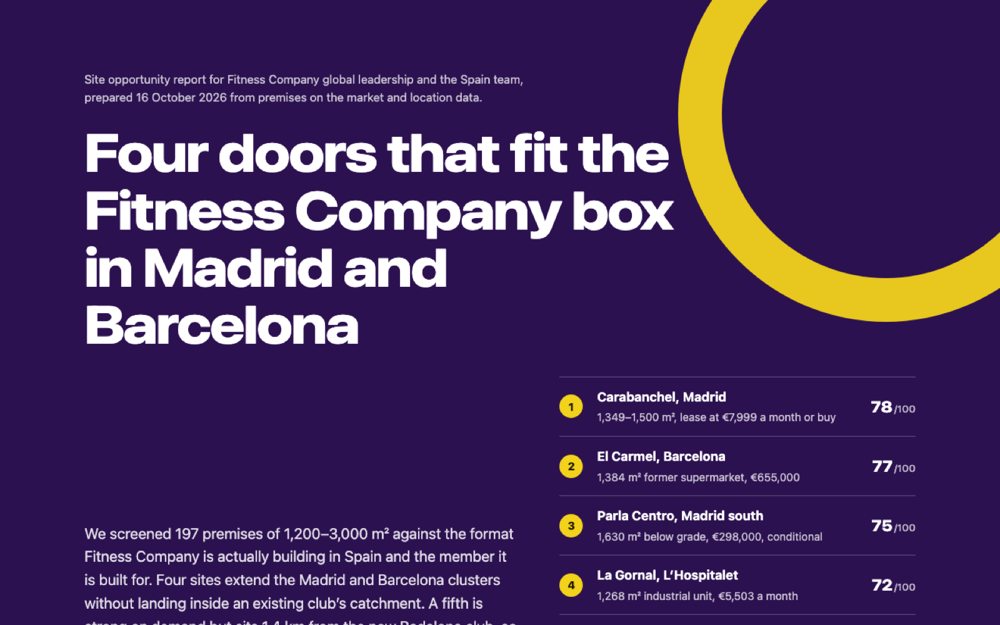](https://casafari.github.io/casafari-mcp/examples/claude-reports/fitness-company-spain-madrid-barcelona.html) | **[Fitness Company Spain: site opportunities in Madrid and Barcelona](https://casafari.github.io/casafari-mcp/examples/claude-reports/fitness-company-spain-madrid-barcelona.html)**<br>197 premises of 1,200–3,000 m² screened against the large-box format the company builds in Spain and the member it is built for; four doors that fit, with the rules, the scoring and a dossier per site. |
| [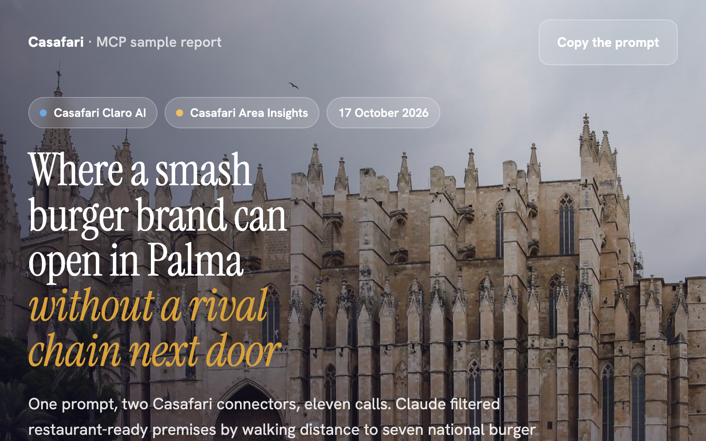](https://casafari.github.io/casafari-mcp/examples/claude-reports/smash-burger-network-gaps-palma.html) | **[Smash burger network gaps in Palma de Mallorca](https://casafari.github.io/casafari-mcp/examples/claude-reports/smash-burger-network-gaps-palma.html)**<br>7 restaurant-ready premises checked on foot against seven national burger chains: one is clear on a verified address, in Son Gotleu; the centre is taken, the gap is east, where apartment asking prices rose 12.5% in a year. |
| [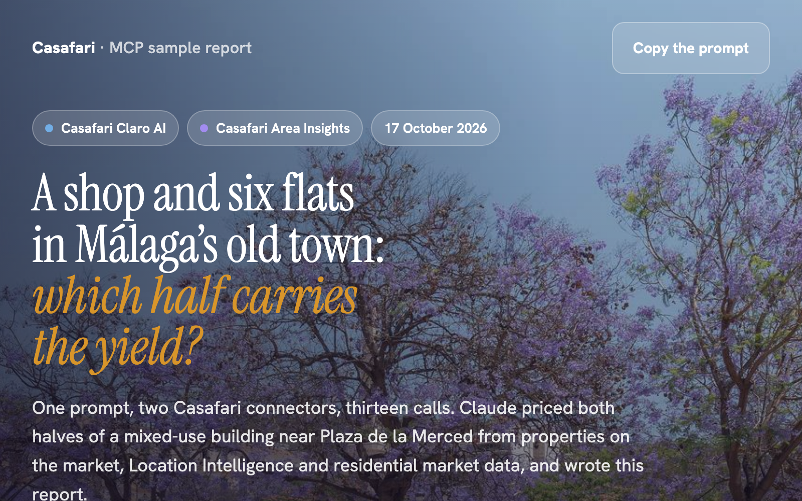](https://casafari.github.io/casafari-mcp/examples/claude-reports/mixed-use-building-malaga-old-town.html) | **[A shop and six flats in Málaga’s old town: which half carries the yield?](https://casafari.github.io/casafari-mcp/examples/claude-reports/mixed-use-building-malaga-old-town.html)**<br>A mixed-use building near Plaza de la Merced priced half by half: about €13,116 a month in gross rent against an asking value of about €2.73m (5.8% gross); the flats bring 82% of the rent, the shop yields 8.1% against 5.4%. |
| [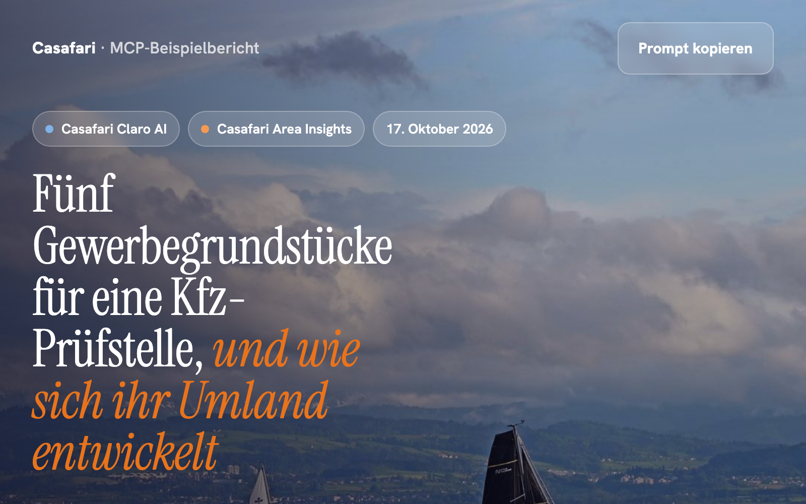](https://casafari.github.io/casafari-mcp/examples/claude-reports/kfz-pruefstelle-gewerbegrundstuecke-bayern-baden-wuerttemberg.html) | **[Fünf Gewerbegrundstücke für eine Kfz-Prüfstelle in Bayern und Baden-Württemberg (German)](https://casafari.github.io/casafari-mcp/examples/claude-reports/kfz-pruefstelle-gewerbegrundstuecke-bayern-baden-wuerttemberg.html)**<br>Commercial plots in Germany: 41 serviced GE and GI plots of 2,000–4,000 m² near a motorway or federal road; the top five opened in full and ranked with three years of house prices and supply within 10 km. Lichtenfels leads at €85/m² on the A73. |
| [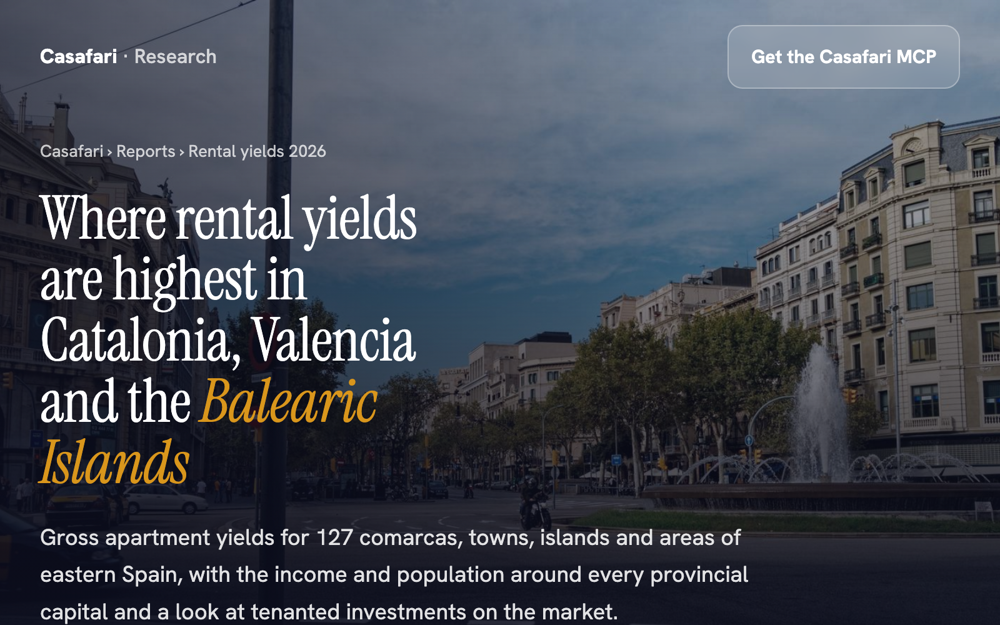](https://casafari.github.io/casafari-mcp/examples/claude-reports/rental-yields-catalonia-valencia-balearics-2026.html) | **[Rental yields in Catalonia, Valencia and the Balearic Islands (2026)](https://casafari.github.io/casafari-mcp/examples/claude-reports/rental-yields-catalonia-valencia-balearics-2026.html)**<br>Built from Area Insights heatmaps (<code>locations_search</code>, <code>get_heatmap</code>) for apartment asking prices and rents in 127 comarcas, towns and islands, turned into gross yields (rent per m² × 12 ÷ price per m²); Claro AI adds <code>claro_explain_location</code> around the provincial capitals and <code>claro_search_premises</code> for tenanted retail for sale. |

<sub>Edited for publication only to remove portal names and a client's name. Figures are Claro AI's: asking prices; footfall is an index for comparing places, not a head count.</sub>

## One brief, one honest answer

A real call to Claro AI, run on 16 October 2026:

> **"Specialty coffee shop in Barcelona, street level, 60-120 m², smoke outlet, rent under 4,000 euros a month"**

Claro reads the brief into criteria, checks every commercial premises for rent in Barcelona against each one, and counts exactly:

| | |
|---|---|
| **1,025** premises | contradict no criterion |
| **69** of them | state every criterion in their own words |
| **956** | leave something unsaid: marked *not stated*, never *no* |

The top result, as the agent receives it:

> **Shell unit in La Marina de Port, Barcelona** · 98 m² · **€1,650 a month**
> ✅ price · ✅ size · ✅ street level · ✅ smoke outlet · ✅ suited to a café
> Facts read from its own text: shop window, 6.22 m frontage, 3.74 m ceiling.
> Around it: footfall index 99,070 within a 5-minute walk (weekdays 105,429, weekends 82,931), 24,511 residents within a 10-minute walk, 3 cafés nearby.
> Every figure carries its unit, source and vintage. The link goes to the agency's own page.

And the same answer as data, ready to chart:

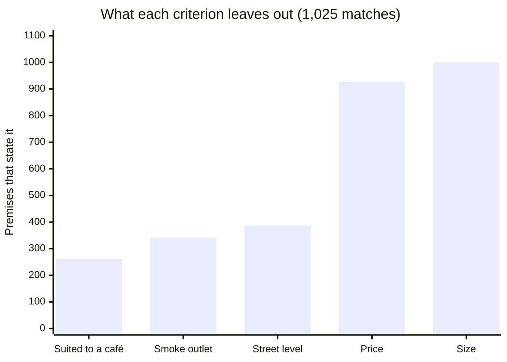

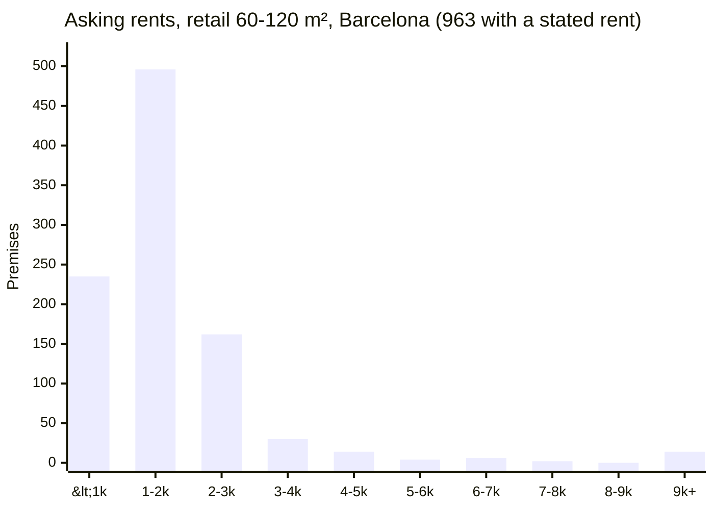

<sub>Median asking rent €1,400 a month. 927 of 963 fit the €4,000 budget. Asking prices, each unit counted once.</sub>


## How it fits together

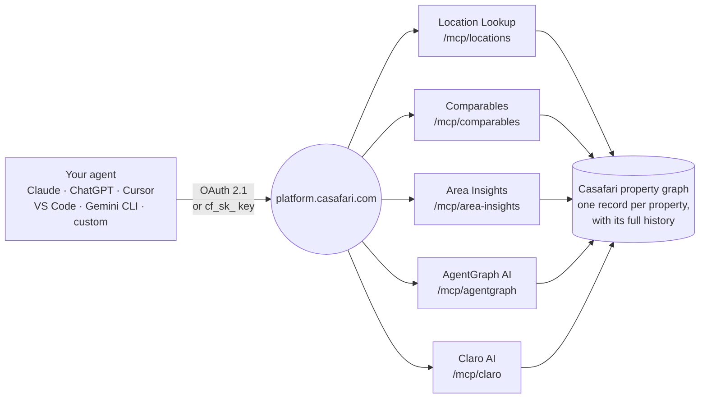

One account, one key and one balance of units work on every server. Location Lookup is free and gives the location ids the other products take.

## What you can ask

| Ask your agent | Server |
|---|---|
| *"What is a 3-bedroom flat of 110 m² near Avenida da Liberdade, Lisbon, worth? Use comparables within 1 km."* | Comparables |
| *"How has the asking price per m² of flats in Valencia moved over the last three years?"* | Area Insights |
| *"Which districts of Madrid have the highest price per m²?"* | Area Insights |
| *"Find corner units in Madrid with a smoke outlet and no burger chain within 300 m."* | Claro AI |
| *"Where in Barcelona do many people live and is there no gym?"* | Claro AI |
| *"Which growing independent agencies in Munich should we approach?"* | AgentGraph AI |
| *"What's the location id for Málaga?"* | Location Lookup |

## The five MCP servers

Each server has a server card at `<url>/.well-known/mcp/server-card.json`. Tools are named `<server>_<tool>`, and every server also has `account_status`.

| Name | URL | What it does | Glama |
|---|---|---|---|
| `casafari-comparables` | `https://platform.casafari.com/mcp/comparables` | Comparable properties and price estimates for a subject property (`comparables_get_comparables`). | [](https://glama.ai/mcp/connectors/com.casafari/comparables) |
| `casafari-area-insights` | `https://platform.casafari.com/mcp/area-insights` | Price series, price, bedroom and time-on-market distributions, growth and volatility, heatmaps by district. | [](https://glama.ai/mcp/connectors/com.casafari/area-insights) |
| `casafari-locations` | `https://platform.casafari.com/mcp/locations` | Find a place by name and get the location id every other product takes. Free. | [](https://glama.ai/mcp/connectors/com.casafari/locations) |
| `casafari-agentgraph` | `https://platform.casafari.com/mcp/agentgraph` | Real estate agencies and agents in Germany: screens, profiles, territory maps, partner briefs. Verified businesses only. | [](https://glama.ai/mcp/connectors/com.casafari/agentgraph) |
| `casafari-claro` | `https://platform.casafari.com/mcp/claro` | Commercial premises across Spain and commercial plots in Germany, searched from a brief in plain words. | [](https://glama.ai/mcp/connectors/com.casafari/claro) |

MCP clients sign in with OAuth 2.1 in the browser: the server answers `401` with a `WWW-Authenticate` header that points to its protected-resource metadata, and a client discovers the rest from there. No key to copy. Unattended agents use a platform API key instead (`cf_sk_...`, as `Authorization: Bearer` or `X-API-Key`).

## Connect

Connect Location Lookup first; it is free and gives the ids the other products take. Docs for every client: https://developers.casafari.com/docs/connect.md

### Claude (claude.ai and desktop)

Settings, Connectors, add a custom connector, paste a server URL from the table (for example `https://platform.casafari.com/mcp/comparables`) and sign in. Repeat for each server you want.

### Claude Code

Install the plugin from this repository (all five servers and five skills):

```bash
claude plugin marketplace add casafari/casafari-mcp
claude plugin install casafari@casafari
```

Or add servers one by one, then run `/mcp` to sign in:

```bash
claude mcp add --transport http casafari-comparables https://platform.casafari.com/mcp/comparables
claude mcp add --transport http casafari-area-insights https://platform.casafari.com/mcp/area-insights
claude mcp add --transport http casafari-locations https://platform.casafari.com/mcp/locations
claude mcp add --transport http casafari-agentgraph https://platform.casafari.com/mcp/agentgraph
claude mcp add --transport http casafari-claro https://platform.casafari.com/mcp/claro
```

Docs: https://code.claude.com/docs/en/plugins and https://code.claude.com/docs/en/mcp

### Cursor

From the [Cursor Directory](https://cursor.directory/plugins/casafari), or one-click install links below.

One-click install, one link per server (format from https://cursor.com/docs/mcp/install-links):

- [casafari-comparables](cursor://anysphere.cursor-deeplink/mcp/install?name=casafari-comparables&config=eyJ1cmwiOiJodHRwczovL3BsYXRmb3JtLmNhc2FmYXJpLmNvbS9tY3AvY29tcGFyYWJsZXMifQ==)
- [casafari-area-insights](cursor://anysphere.cursor-deeplink/mcp/install?name=casafari-area-insights&config=eyJ1cmwiOiJodHRwczovL3BsYXRmb3JtLmNhc2FmYXJpLmNvbS9tY3AvYXJlYS1pbnNpZ2h0cyJ9)
- [casafari-locations](cursor://anysphere.cursor-deeplink/mcp/install?name=casafari-locations&config=eyJ1cmwiOiJodHRwczovL3BsYXRmb3JtLmNhc2FmYXJpLmNvbS9tY3AvbG9jYXRpb25zIn0=)
- [casafari-agentgraph](cursor://anysphere.cursor-deeplink/mcp/install?name=casafari-agentgraph&config=eyJ1cmwiOiJodHRwczovL3BsYXRmb3JtLmNhc2FmYXJpLmNvbS9tY3AvYWdlbnRncmFwaCJ9)
- [casafari-claro](cursor://anysphere.cursor-deeplink/mcp/install?name=casafari-claro&config=eyJ1cmwiOiJodHRwczovL3BsYXRmb3JtLmNhc2FmYXJpLmNvbS9tY3AvY2xhcm8ifQ==)

Or put this in `~/.cursor/mcp.json` (or `.cursor/mcp.json` in a project), schema from https://cursor.com/docs/mcp:

```json
{
  "mcpServers": {
    "casafari-comparables": {
      "url": "https://platform.casafari.com/mcp/comparables"
    },
    "casafari-area-insights": {
      "url": "https://platform.casafari.com/mcp/area-insights"
    },
    "casafari-locations": {
      "url": "https://platform.casafari.com/mcp/locations"
    },
    "casafari-agentgraph": {
      "url": "https://platform.casafari.com/mcp/agentgraph"
    },
    "casafari-claro": {
      "url": "https://platform.casafari.com/mcp/claro"
    }
  }
}
```

This repository is also a Cursor plugin (`.cursor-plugin/plugin.json`, `mcp.json`, `plugin/skills/`), see https://cursor.com/docs/plugins.

### VS Code

`.vscode/mcp.json` (schema: https://code.visualstudio.com/docs/copilot/customization/mcp-servers):

```json
{
  "servers": {
    "casafari-comparables": {
      "type": "http",
      "url": "https://platform.casafari.com/mcp/comparables"
    },
    "casafari-area-insights": {
      "type": "http",
      "url": "https://platform.casafari.com/mcp/area-insights"
    },
    "casafari-locations": {
      "type": "http",
      "url": "https://platform.casafari.com/mcp/locations"
    },
    "casafari-agentgraph": {
      "type": "http",
      "url": "https://platform.casafari.com/mcp/agentgraph"
    },
    "casafari-claro": {
      "type": "http",
      "url": "https://platform.casafari.com/mcp/claro"
    }
  }
}
```

### ChatGPT

Turn on Developer mode in ChatGPT's settings (Apps and Connectors, advanced settings), create a connector, paste a server URL from the table as the MCP server URL, choose OAuth and sign in. Steps as published at https://developers.casafari.com/docs/connect.md.

### Gemini CLI

Install the extension (all five servers and `GEMINI.md`):

```bash
gemini extensions install https://github.com/casafari/casafari-mcp
```

Then run `/mcp auth casafari-comparables` (and the others) inside Gemini CLI. Or add servers one by one; the entry lands in `.gemini/settings.json` as `httpUrl`:

```bash
gemini mcp add --transport http casafari-comparables https://platform.casafari.com/mcp/comparables
gemini mcp add --transport http casafari-area-insights https://platform.casafari.com/mcp/area-insights
gemini mcp add --transport http casafari-locations https://platform.casafari.com/mcp/locations
gemini mcp add --transport http casafari-agentgraph https://platform.casafari.com/mcp/agentgraph
gemini mcp add --transport http casafari-claro https://platform.casafari.com/mcp/claro
```

Docs: https://github.com/google-gemini/gemini-cli/tree/main/docs/extensions

### Any other MCP client

Any client that supports remote MCP servers over Streamable HTTP with OAuth works: give it a server URL from the table.

### AWS: Kiro, Amazon Quick and Amazon Bedrock AgentCore Gateway

Kiro and Amazon Quick take a server URL and sign in with OAuth, like the clients above. Amazon Bedrock AgentCore Gateway adds each server as an MCP server target and sends a platform API key (`X-API-Key`) that it keeps in AgentCore Identity. Steps for all three: https://developers.casafari.com/docs/aws

Runnable sample in Python: [`examples/aws-agentcore`](examples/aws-agentcore) creates a gateway with Location Lookup, Comparables and Area Insights as targets and asks a Strands Agents agent one question through it. Tool calls spend tokens from your Casafari account (Location Lookup is free) and the gateway and model cost AWS charges; its README lists both.

## REST quick start

Base URL `https://platform.casafari.com/v1`, OpenAPI at https://platform.casafari.com/v1/openapi.json (one per product at `/v1/<product>/openapi.json`, Claro at https://platform.casafari.com/v1/claro/openapi.json). Send the key as `Authorization: Bearer` or `X-API-Key`, never in a query string.

```bash
export CASAFARI_API_KEY=cf_sk_...   # from https://platform.casafari.com/console/

# Location Lookup (free)
curl -H "Authorization: Bearer $CASAFARI_API_KEY" \
  "https://platform.casafari.com/v1/locations/search?query=Madrid&country=ES"

# Comparables
curl -X POST https://platform.casafari.com/v1/comparables/search \
  -H "Authorization: Bearer $CASAFARI_API_KEY" -H "Content-Type: application/json" \
  -d '{"operation":"sale","comparables_types":["apartment"],"comparables_count":5,
       "location_boundary":{"circle":{"distance":1,"target_point":{"coordinates":{"latitude":40.4168,"longitude":-3.7038}}}}}'
```

Full examples in [`examples/`](examples): [curl](examples/curl.sh), [Python](examples/python.py) and [TypeScript](examples/typescript.ts), each a Location Lookup, a Comparables call and a Claro search.

The existing Casafari API at api.casafari.com is for contract clients only; its tokens do not work on the platform.

## What is in this repository

| Path | For |
|---|---|
| `plugin/` (`.claude-plugin/plugin.json`, `.mcp.json`, `skills/`, icon), `.claude-plugin/marketplace.json` | Claude Code plugin and self-hosted marketplace |
| `.cursor-plugin/plugin.json`, `mcp.json`, `plugin/skills/` | Cursor plugin |
| `gemini-extension.json`, `GEMINI.md` | Gemini CLI extension |
| `examples/` | REST examples; `examples/aws-agentcore/`, the Amazon Bedrock AgentCore Gateway sample |

Skills: `casafari-comparables`, `casafari-area-insights`, `casafari-locations`, `casafari-agentgraph`, `casafari-claro`.

## Links

- Docs: https://developers.casafari.com (machine-readable: https://developers.casafari.com/llms.txt)
- Example reports: https://developers.casafari.com/docs/claro/examples
- Platform and console: https://platform.casafari.com
- Terms: https://developers.casafari.com/legal/platform-terms
- Contact: platform@casafari.com
- Security: see [SECURITY.md](SECURITY.md)

Licensed under the [Apache License 2.0](LICENSE).
