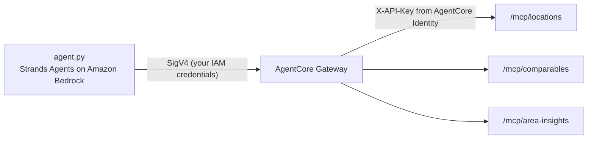

# Casafari on Amazon Bedrock AgentCore Gateway

A small Python sample: it puts three of Casafari's MCP servers behind one [Amazon Bedrock AgentCore Gateway](https://docs.aws.amazon.com/bedrock-agentcore/latest/devguide/gateway.html) and asks a [Strands Agents](https://strandsagents.com) agent one question through it.

| Gateway target | Casafari MCP server | What it answers |
|---|---|---|
| `locations` | `https://platform.casafari.com/mcp/locations` | Location Lookup: place names to location ids. Free |
| `comparables` | `https://platform.casafari.com/mcp/comparables` | Comparable properties and a price estimate for a subject property |
| `area-insights` | `https://platform.casafari.com/mcp/area-insights` | Asking price series, distributions and heatmaps for an area |



The gateway reaches Casafari with a platform API key kept in AgentCore Identity: Gateway signs in to an MCP target with a stored credential and does not register itself as an OAuth client, so an API key is the way in. Your agent never sees the key.

Step-by-step docs, with Kiro and Amazon Quick too: https://developers.casafari.com/docs/aws

## Costs

Running this spends money on two sides.

- **Casafari tokens.** Every tool call is billed to your Casafari account in tokens, except Location Lookup's, which are free. At the time of writing a Comparables call costs 20 tokens and an Area Insights call up to 10; each operation's cost is `x-casafari-units` in the product's OpenAPI description (for example https://platform.casafari.com/v1/comparables/openapi.json). The Free plan has 1,000 tokens for 30 days, with no card. An agent may call several tools for one question.
- **AWS charges** in your account: AgentCore Gateway requests and tool indexing, the Amazon Bedrock model's tokens, and the AWS Secrets Manager secret that holds the key. See the AWS pricing pages for AgentCore, Bedrock and Secrets Manager. Run `python setup_gateway.py --delete` when you are done.

## Before you start

- **Python 3.10 or later** and AWS credentials in your shell (`aws configure`, SSO or environment variables).
- **A Casafari platform API key.** Sign up at https://platform.casafari.com/console/ (Free plan, no card) and create a key. It starts with `cf_sk_` and is shown once. Keep it in the environment as `CASAFARI_API_KEY`; never commit it.
- **An AWS Region where AgentCore Gateway runs**, in `AWS_REGION`.
- **Amazon Bedrock model access** in that Region for the model the agent uses (see `BEDROCK_MODEL_ID` below).

### IAM

- **Who runs `setup_gateway.py`** needs AgentCore Gateway and Identity permissions (the AWS managed policy `BedrockAgentCoreFullAccess` covers them) and, for the gateway's role, `iam:CreateRole`, `iam:GetRole`, `iam:PutRolePolicy`, `iam:PassRole`, `iam:DeleteRolePolicy` and `iam:DeleteRole` on `arn:aws:iam::<account>:role/casafari-agentcore-gateway`.
- **The gateway's role**, which the script creates, can be assumed only by `bedrock-agentcore.amazonaws.com` from your account. It may get a workload access token for this gateway, read this one API key from AgentCore Identity (`bedrock-agentcore:GetResourceApiKey`) and read its secret (`secretsmanager:GetSecretValue`), and nothing else.
- **Who runs `agent.py`** needs `bedrock-agentcore:InvokeGateway` on the gateway (its inbound authorization is AWS IAM) and `bedrock:InvokeModelWithResponseStream` on the model or inference profile.

## Run it

```bash
cd examples/aws-agentcore
python3 -m venv .venv && . .venv/bin/activate
pip install -r requirements.txt

export AWS_REGION=eu-central-1             # any Region where AgentCore Gateway runs
export CASAFARI_API_KEY=cf_sk_...          # your key; read from the environment only

python setup_gateway.py                    # creates the key provider, role, gateway and targets
export CASAFARI_GATEWAY_URL=https://...    # printed by setup_gateway.py
unset CASAFARI_API_KEY                     # the gateway has it now; the agent does not need it

python agent.py
python agent.py "Which districts of Lisbon have the highest asking price per m2 for flats?"

python setup_gateway.py --delete           # removes the targets, gateway, role and stored key
```

`setup_gateway.py` is safe to run again: it reuses the gateway and targets that exist and replaces the stored key with the current `CASAFARI_API_KEY`, which is how you rotate it. When a target is created the gateway calls that server's `tools/list` with the key, so a wrong or revoked key shows up as a failed target.

The default question is *"What is a 2-bedroom flat of 85 m² near Avenida da Liberdade, Lisbon worth? Use comparables within 1 km."*

### Choosing the model

`agent.py` uses Strands Agents' default Amazon Bedrock model unless `BEDROCK_MODEL_ID` is set. In strands-agents 1.61 the default is a global cross-Region inference profile of Claude Sonnet. To keep inference in one geography, set `BEDROCK_MODEL_ID` to an inference profile there that your account can use, for example an EU profile of a Claude model from the Bedrock console.

## Notes

- **Tool names.** The gateway names each tool `<target>___<tool>`, for example `comparables___comparables_get_comparables`, and an Amazon Bedrock model takes tool names of at most 64 characters. That is why the targets are called `locations`, `comparables` and `area-insights` and not `casafari-area-insights`: `area-insights___area-insights_get_time_on_market_distribution` is already 61.
- **New tools.** The gateway indexes each server's tools when the target is created. When Casafari adds a tool, call `SynchronizeGatewayTargets` for that target.
- **Claro AI.** Commercial premises in Spain and commercial plots in Germany: uncomment the `claro` line in `TARGETS` in `setup_gateway.py`. Your key carries the products your plan had when you created it.
- **Inbound authorization.** The gateway uses AWS IAM, so only callers you grant `bedrock-agentcore:InvokeGateway` reach it. For your own identity provider, create the gateway with `CUSTOM_JWT` instead (AgentCore docs: "Set up inbound authorization for your gateway").

## What was tested

Checked on 2026-10-20 without an AWS account:

- every AgentCore and IAM request the script sends validates against the service model of botocore 1.43.115;
- `setup_gateway.py` runs its create and delete paths against botocore stubs, including the retry while a new role becomes usable;
- `agent.py`'s gateway client (mcp-proxy-for-aws 1.7.0 with Strands Agents 1.61.1) signs requests and lists tools from a local Streamable HTTP server.

**Not yet run end to end** in an AWS account against platform.casafari.com. If something fails there, please open an issue or write to platform@casafari.com.

## Sources

- AgentCore Gateway MCP server targets: https://docs.aws.amazon.com/bedrock-agentcore/latest/devguide/gateway-target-MCPservers.html
- Outbound authorization with an API key: https://docs.aws.amazon.com/bedrock-agentcore/latest/devguide/gateway-outbound-auth.html
- Inbound authorization (IAM): https://docs.aws.amazon.com/bedrock-agentcore/latest/devguide/gateway-inbound-auth.html
- Gateway service role: https://docs.aws.amazon.com/bedrock-agentcore/latest/devguide/gateway-prerequisites-permissions.html
- Tool naming: https://docs.aws.amazon.com/bedrock-agentcore/latest/devguide/gateway-tool-naming.html
- SigV4 MCP client: https://github.com/aws/mcp-proxy-for-aws
